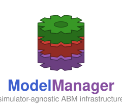

<p align="center"></p>

# ModelManager.jl

[](https://drbergman-lab.github.io/ModelManager.jl/stable/)
[](https://drbergman-lab.github.io/ModelManager.jl/dev/)
[](https://github.com/drbergman-lab/ModelManager.jl/actions/workflows/CI.yml?query=branch%3Amain)
[](https://codecov.io/gh/drbergman-lab/ModelManager.jl)

Simulator-agnostic infrastructure for agent-based model (ABM) management in Julia.

ModelManager provides the generic base layer for managing simulation runs, parameter variations, sensitivity analysis, and database bookkeeping. Simulator-specific packages (e.g. [PhysiCellModelManager.jl](https://github.com/drbergman-lab/PhysiCellModelManager.jl)) extend this package by implementing the `AbstractSimulator` interface.

## Quick start

ModelManager is not used directly by end users — use a concrete simulator package instead. If you are building a new simulator package on top of ModelManager:

1. Add the BergmanLabRegistry:
```julia-repl
pkg> registry add https://github.com/drbergman-lab/BergmanLabRegistry
```
2. Add ModelManager as a dependency:
```julia-repl
pkg> add ModelManager
```
3. Define your simulator:
```julia
using ModelManager

mutable struct MySimulator <: AbstractSimulator
    dir::String
    # ...simulator-specific fields
end
```
4. Implement the required interface methods (see `AbstractSimulator` docstring).
5. Register your simulator in your package's `__init__`:
```julia
function __init__()
    ModelManager.registerSimulator!(MySimulator(...))
end
```

---

## Roadmap

- [ ] `createProject` generic entry point
- [ ] GP-accelerated ABC and further calibration methods as subtypes of `AbstractCalibrationMethod`
- [ ] Additional distance functions — `maeDistance` and normalized variants; `mseDistance` is currently the only built-in
